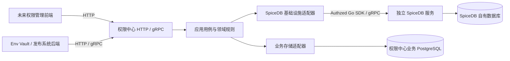

# Olixops Permission Center

独立的多租户、多系统权限中心 Go 后端。以 SpiceDB 保存授权关系和计算权限，向 Env Vault、发布系统等业务应用提供统一能力。开发前先阅读 [AGENTS.md](AGENTS.md)，数据库相关工作遵守 [表设计与初始化说明](design/database.md)。

## 当前实现

项目已有初始化骨架，本次在原有项目上补齐 SpiceDB 客户端和通用规范，没有重新创建 Go 模块或升级 `go 1.26` 指令。

| 能力 | 当前状态 |
|---|---|
| DDD 目录、统一启动入口 | 已有，根 `main.go` 和 `cmd/server/main.go` 共用启动装配 |
| Gin、GORM/PostgreSQL、go-redis、zap | 已有基础依赖与适配 |
| HTTP 响应、分页、trace-id、JWT | 已有基础能力，本次对齐错误、安全与配置约定 |
| grpc-go / protobuf | 已有标准健康服务和自定义 `Healthy` |
| SpiceDB Go SDK | 新增官方 `github.com/authzed/authzed-go v1.10.0`，可选连接、TLS、启动健康检查、超时与关闭 |
| 文档与配置模板 | 更新唯一开发规范与完整说明，安全模板独立于用户本地配置 |
| `CheckPermission` RPC | 仅有 proto 与生成代码，未注册业务服务，不能调用 |
| 租户、系统、角色、授权和审计业务 | 尚未实现，需先完成领域及数据库设计 |
| 前端、业务接入 SDK、登录签发 | 当前仓库未实现 |

本次初始化不创建业务表，不修改用户已导入的 SpiceDB Schema/关系，不部署或修改 Kubernetes 资源。

## 架构与数据归属



图中管理前端和业务用例是目标架构；当前仅有传输骨架、健康用例和基础设施初始化。领域层不依赖 Gin/GORM/SpiceDB SDK，HTTP 与 gRPC 将共享应用用例。

租户表示公司，组织归属于租户；系统表示可被多个租户启用的全局业务应用。授权明确绑定租户、系统及资源范围，不将“租户→组织→系统”作为单一树，也不默认让某个范围的管理员拥有其他范围权限。相关表结构尚未审批或创建。

用户及业务资源可以继续由接入系统负责；本项目业务库将保存接入配置、授权管理元数据和审计等内容。SpiceDB 内部表由 SpiceDB/Operator 管理，本项目不能直接修改。业务写入与关系写入需要明确一致性及重试方案，不能视为同一个 PostgreSQL 事务。

## 完整源码结构

以下列出项目维护的源码和配置入口；省略 IDE 配置、依赖缓存、本地秘密配置及构建产物。

```text
olixops-permission-center/
├── AGENTS.md                         # 唯一 Agent 开发规范
├── README.md                         # 当前实现、运行、配置与验证
├── go.mod / go.sum                    # 模块版本及依赖锁定
├── .env.example                     # 环境变量清单，程序不自动加载 .env
├── main.go                           # GoLand 兼容入口
├── cmd/server/main.go                # 标准服务入口
├── config/config.example.yaml        # 可提交的安全配置模板
├── api/
│   ├── openapi.yaml                  # HTTP OpenAPI 3 独立分发文档
│   ├── proto/README.md               # 生成方式
│   ├── proto/health/v1/health.proto   # Healthy 契约
│   ├── proto/permission/v1/permission.proto # 待实现的权限契约
│   └── gen/{health,permission}/v1/   # *.pb.go / *_grpc.pb.go
├── design/database.md                # 建库授权与后续表设计审批
├── internal/
│   ├── bootstrap/run.go              # 配置、依赖、HTTP/gRPC 生命周期
│   ├── bootstrap/run_test.go         # 无外部依赖的启动与退出测试
│   ├── domain/doc.go                 # 领域层边界，目前没有业务实体
│   ├── application/
│   │   ├── doc.go
│   │   └── health/service.go         # 共用健康检查用例
│   ├── infrastructure/
│   │   ├── doc.go
│   │   ├── cache/redis.go            # Redis 客户端
│   │   ├── persistence/postgres.go   # PostgreSQL/GORM 连接
│   │   └── spicedb/                  # Authzed 客户端、健康检查及测试
│   └── interfaces/
│       ├── doc.go
│       ├── http/
│       │   ├── router.go            # 公开与认证路由、统一错误入口
│       │   ├── router_test.go       # 响应、认证和路由契约测试
│       │   ├── handler/handler.go   # healthz / auth/me
│       │   └── middleware/          # JWT、request-id、recovery、访问日志
│       └── grpc/
│           ├── server.go            # 注册标准和自定义 health
│           ├── health_server.go     # Healthy 协议适配
│           ├── interceptor.go       # unary / stream 通用入口
│           ├── interceptor_test.go  # 认证、恢复和 trace 测试
│           └── server_test.go       # 连通性测试
├── pkg/
│   ├── auth/                        # HTTP/gRPC 共用 JWT 验签与测试
│   ├── config/                      # 配置加载、覆盖、校验及测试
│   ├── logger/logger.go             # 全局 zap 包装
│   ├── page/                        # pageNum/pageSize → total/list
│   ├── response/response.go         # code/msg/data
│   └── userctx/user.go              # 请求内用户上下文
├── Dockerfile                       # 多阶段构建，只复制安全配置模板
├── .dockerignore                    # 排除本地配置、秘密和构建产物
└── .gitignore                       # 排除本地配置与生成文档
```

具体开发规则和分层约束以 [AGENTS.md](AGENTS.md) 为准；HTTP 契约见 [api/openapi.yaml](api/openapi.yaml)，protobuf 生成步骤见 [api/proto/README.md](api/proto/README.md)。Handler 维护 swag 注解，生成的 `docs/` 不提交版本库。

## 配置与本地运行

使用 `go.mod` 指定的 Go 1.26，依赖版本以 `go.mod/go.sum` 为准。以下命令在本项目根目录、PowerShell 中运行。

```powershell
go mod download
$env:CONFIG_FILE = 'config/config.example.yaml'
go run ./cmd/server
```

安全模板默认不连接 PostgreSQL、Redis 或 SpiceDB，适合先验证 HTTP/gRPC 骨架。`go run .` 进入同一个启动过程。服务响应 Ctrl+C/SIGTERM，在配置的上限内停止 HTTP/gRPC 并关闭 PostgreSQL、Redis、SpiceDB 连接。已配置的依赖初始化失败时退出；Redis 启用后会通过 Ping 验证连接。

用户已有 `config/config.yaml` 会保留且不再作为可提交模板；默认未设置 `CONFIG_FILE` 时读取它。默认文件不存在时使用默认值；显式指定的文件不存在或配置格式、类型错误时返回安全错误。环境变量优先于文件，文件优先于内置默认值。

| 环境变量 | 文件配置 | 默认值 / 用途 |
|---|---|---|
| `CONFIG_FILE` | — | `config/config.yaml`，选择配置路径 |
| `APP_ENV` | `app.environment` | `development`；`production/release` 使用生产日志 |
| `HTTP_ADDR` | `server.http.host/port` | `:8080`，HTTP 监听地址 |
| `GRPC_ADDR` | `server.grpc.host/port` | `:9090`，本服务 gRPC 监听地址 |
| `HTTP_READ_TIMEOUT` | `server.http.read_timeout` | `10s` |
| `HTTP_WRITE_TIMEOUT` | `server.http.write_timeout` | `30s` |
| `HTTP_IDLE_TIMEOUT` | `server.http.idle_timeout` | `60s` |
| `SHUTDOWN_TIMEOUT` | `server.shutdown_timeout` | `5s`，优雅退出上限 |
| `DATABASE_DSN` | `database.*` | 未配置则跳过；也可组合 host/port/user/password/name/schema/ssl_mode |
| `REDIS_ADDR` | `redis.addrs` | 未配置则跳过；当前只支持单实例地址，多个地址配置会报错 |
| `REDIS_PASSWORD` | `redis.password` | 空；通过环境或 Secret 注入 |
| `REDIS_DB` | `redis.db` | `0` |
| — | `redis.enabled` | `false` 可关闭文件中的 Redis 连接 |
| `AUTH_JWT_PUBLIC_KEY` | `auth.jwt-public-key` | 空；外部 JWT RSA 公钥，PEM 或 base64 DER |
| `AUTH_JWT_ISSUER` | `auth.issuer` | 空；受信任 JWT 签发者 |
| `AUTH_JWT_AUDIENCE` | `auth.audience` | 空；此服务要求的 JWT audience |
| `SPICEDB_ENABLED` | `spicedb.enabled` | `false`；明确启用客户端 |
| `SPICEDB_ENDPOINT` | `spicedb.endpoint` | 空；SpiceDB 的 `host:port` |
| `SPICEDB_TOKEN` | `spicedb.token` | 空；由环境或 Secret 注入的访问密钥 |
| `SPICEDB_INSECURE` | `spicedb.insecure` | `false`；显式使用无 TLS 连接 |
| `SPICEDB_CA_FILE` | `spicedb.ca-file` | 空；自定义 CA 文件，空时使用系统信任 |
| `SPICEDB_SERVER_NAME` | `spicedb.server-name` | 空；可选 TLS 服务端证书名称 |
| `SPICEDB_TIMEOUT` | `spicedb.timeout` | `5s`；启动探测及 unary 调用超时 |

旧 `auth.jwt_public_key` 仍兼容，新增配置统一使用 `auth.jwt-public-key`。文件支持 `${VAR}` 和 `${VAR:-default}` 占位；先解析 YAML 再展开字段值，避免凭据中的特殊字符改变 YAML 结构。支持范围以安全模板和配置加载代码为准，旧配置中未使用的扩展字段不代表相应功能已经实现。

### 启用 SpiceDB

Go SDK 是 [官方 Authzed Go 客户端](https://github.com/authzed/authzed-go)，模块名为 `github.com/authzed/authzed-go`，当前锁定 v1.10.0。

当前部署的本地开发入口为 `192.168.1.103:30031`；在同一 Kubernetes 集群中可使用 `dev.spicedb-poc.svc.cluster.local:50051`。这是现有部署的参考地址，模板不内置私人网络地址。

先通过环境或 Secret 设置 `SPICEDB_TOKEN`。以下示例不写入真实密钥：

```powershell
$env:CONFIG_FILE = 'config/config.example.yaml'
$env:SPICEDB_ENABLED = 'true'
$env:SPICEDB_ENDPOINT = '192.168.1.103:30031'
$env:SPICEDB_INSECURE = 'true'
go run ./cmd/server
```

该入口当前使用明文 gRPC，才需要 `SPICEDB_INSECURE=true`；生产使用 TLS，按需要配置 CA 和服务端名称。启用但缺少配置、连接失败或超时时，初始化返回错误，不能静默当成已接入。

启动仅执行标准健康检查，复用连接并在退出时关闭；不会读取/修改 Schema，也不会写入关系。**SpiceDB 的标准 health 可公开调用，启动探测成功不代表 token 有效或业务权限已经正确。** 后续授权用例需独立验证认证、模型和关系，并通过基础设施适配调用 SDK。Unary 调用自动应用配置超时；Watch 等流式调用由调用方设置 context 生命周期与取消，不使用统一的 5 秒流存活上限。

## 当前接口与认证

| 协议 | 接口 | 认证及含义 |
|---|---|---|
| HTTP GET | `/api/v1/pub/healthz` | 公开，进程健康用例 |
| HTTP GET | `/api/v1/auth/me` | Bearer JWT；仅输出 `userId/name` |
| gRPC | `grpc.health.v1.Health/Check`、`Watch` | 公开标准服务健康协议 |
| gRPC | `health.v1.HealthService/Healthy` | 公开自定义连通性检查 |

HTTP 成功为 `{code:0,msg:"",data:...}`；普通业务失败 code 为 -1；HTTP 400/401/403/404/405/500 等错误保留真实状态并统一封装。分页入参为 `pageNum/pageSize`，Handler 默认处理为 1/20、最大 200；响应为 `total/list`，空列表为 `[]`。

JWT 要求 RS256、有效期及配置匹配的 issuer/audience。用户标识来自 `staffuserid`，缺省回退 `sub`；名称来自 `name`。缺少有效认证配置时受保护接口不能访问；本项目不会创建登录账号、签发 JWT 或返回原始 token/Cookie。

健康接口用于连通性，不证明所有业务依赖持续可用。权限业务尚未实现；`permission.v1.PermissionCenterService/CheckPermission` 仅有契约与生成代码，现阶段未注册。其他 RPC 经统一拦截器认证后还需业务层验证服务身份的授权范围，不能沿用健康接口的公开性。

### 连通性验证

```powershell
Invoke-RestMethod 'http://127.0.0.1:8080/api/v1/pub/healthz'
grpcurl -plaintext -import-path api/proto -proto health/v1/health.proto -d '{}' 127.0.0.1:9090 health.v1.HealthService/Healthy
```

`Healthy` 预期返回 `healthy: true`、`message: "ok"`。grpcurl 是可选调试工具，当前自定义服务不依赖 reflection，命令显式传入 proto。标准 health 和 Healthy 的 Go 客户端调用由 gRPC 测试覆盖。

## 日志、安全与部署

日志统一通过 `pkg/logger`；HTTP 读取/生成并回写 `x-request-id`，gRPC 使用同名 metadata，应用通过 context 传递 trace-id。开发日志为带颜色的控制台格式，生产为 JSON，时间保留毫秒与时区。

配置、JWT、Cookie、数据库连接凭据和 SpiceDB token 不进入响应、日志、审计或提交内容。测试使用虚构凭据，不读取已有 Kubernetes Secret。授权结果缓存、自定义角色、组织继承等需要具体设计，当前没有默认放行或临时权限模型。

```powershell
docker build -t olixops-permission-center:local .
docker run --rm -p 8080:8080 -p 9090:9090 olixops-permission-center:local
```

多阶段 Dockerfile 生成独立二进制，运行镜像只带安全示例。真实配置通过挂载文件或环境变量/Kubernetes Secret 注入；业务数据库准备步骤见 [design/database.md](design/database.md)。本项目没有自动创建业务表或部署集群的启动步骤。

## 验证与后续开发

```powershell
go vet ./...
go test ./...
go build ./...

# 从 Handler 注解生成文档，输出 docs/ 不提交
go run github.com/swaggo/swag/cmd/swag@v1.16.6 init -g main.go -o docs --outputTypes json,yaml
```

修改 Go 文件后对修改范围执行 gofmt；仅文档变更检查链接与 `git diff --check`。测试结果以本次实际执行为准，不能把本地测试或 health 成功解释为线上授权功能验收。

下一阶段先确定一期 Schema、租户/系统/资源 ID 与调用方身份，完成表设计审批和接口契约，然后实现分配角色、撤销角色、直接成员查询和权限检查。通过两个业务系统、两个测试租户验证授权范围隔离，再接入统一管理前端。Schema 应版本化测试和受控发布，不在进程启动时导入 Playground 测试文件。
