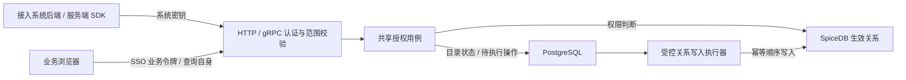

# 通用业务授权设计草案

日期：2026-11-02。状态：**供评审的目标方案，尚未实现或发布**。本文不代表新增表、接口或 SpiceDB Schema 已获批准；数据库唯一 SQL 及审批入口仍为 [database.md](database.md)。术语见 [CONTEXT.md](../CONTEXT.md)。

## 1. 目标与已确认需求

权限中心集中保存接入系统的授权数据，回答：**某个租户的某个系统内，某个主体，是否能对某个资源执行某个动作？**

已确认：

- 面向多个外部系统接入，同时提供 HTTP、gRPC，后续通过 SDK 使用。
- 业务浏览器需要直接访问权限中心，业务用户已有统一登录中心/SSO；具体令牌契约尚待核对。
- 权限中心自身也是接入案例。该案例中，系统成员默认能读取自己加入系统的全部数据，不能读取其他系统数据。
- 上述成员、管理员、超管的例子用于说明自用策略，不是所有接入系统必须遵循的固定权限层级。

建议的首版能力是显式授权、角色授权、按动作配置的范围继承、单次/批量判断与可访问资源查询。自定义布尔表达式、属性条件、显式拒绝优先级、跨系统共享与嵌套角色不作为首版承诺。

权限中心保存主体引用、资源元数据、动作定义、角色及授权关系；工单正文、文件内容等业务数据仍由接入系统保存。接入系统后端负责在实际读写业务数据前执行鉴权。

目标调用关系如下，图中业务授权链路均待实现：



## 2. 现有实现与新增边界

| 代码位置 | 当前事实 | 对本阶段的影响 |
|---|---|---|
| `internal/application/management/service.go` | 后台用户状态、平台超管、租户管理员范围校验 | 保留后台接入管理规则；不能直接当作外部业务资源授权 |
| `design/database.md` 七表 | `tenant_member_info` 只有 `tenant_admin` | 尚无普通系统成员、业务主体或业务资源目录 |
| `internal/infrastructure/spicedb/client.go` | 官方客户端连接、TLS、超时和健康检查 | 复用连接；新增封闭的授权适配器 |
| `api/proto/permission/v1/permission.proto` | `user_id/resource/action` 占位契约 | 缺少类型化资源、主体语义及一致性约定，需要正式设计 |
| `internal/interfaces/grpc/server.go` | 只注册健康服务 | 系统调用认证和业务 RPC 尚未实现 |

现有 `/auth/tenant/list` 表示当前后台用户实际管理的租户，包含 Token 签发资格语义；不把它改成普通业务用户可访问租户列表。业务访问范围发现应另设用例。

## 3. 核心领域与隔离

| 概念 | 建议唯一键/范围 | 示例 |
|---|---|---|
| 接入系统 | 内部 systemId，唯一归属 tenantId | 工单系统 |
| 业务主体 | systemId + subjectType + externalId | user / employee-42 |
| 资源类型 | systemId + typeCode | ticket |
| 业务资源 | systemId + resourceType + externalId | ticket / T-1001 |
| 动作 | systemId + resourceType + actionCode | ticket / approve |
| 业务角色 | systemId + roleCode | approver |
| 资源动作 | 资源内部 ID + 动作内部 ID | T-1001 的 approve |

外部稳定 ID 原样区分大小写，不使用姓名、邮箱等可变显示值作为身份。不同系统都传入 `user/42` 或 `document/1`，仍对应不同内部对象。同一个人在多个系统的主体由可信身份映射关联，不自动共享授权。

内部对象建议使用服务端分配、持久映射的 UUID；客户端不传 SpiceDB 对象 ID。系统及资源归属一经建立不允许通过 upsert 换绑。软删除后重建的身份复用、资源 ID 复用及旧关系清理须在数据库/生命周期设计中明确，默认不释放原身份映射。

每次操作在应用层校验：

1. 从可信认证结果确定可操作的租户、系统及调用能力。
2. 主体、资源、动作、角色全部属于同一系统，且对象状态有效。
3. 每个系统恰好属于一个租户，每个资源恰好属于一个系统。
4. 继承关系不跨系统，首版只继承相同资源类型的相同动作；范围资源可声明适用的资源类型与动作。
5. 首版资源继承为有界单父链，拒绝环、超深和隐式换父；并发变更需要串行校验，不能依靠先查后写防环。

SpiceDB 的类型与对象 ID 前缀不会自动保证这些约束。原始关系写入、Schema 写入不向接入方开放。

## 4. SpiceDB 建模方案与建议

### 4.1 动态动作如何支持

SpiceDB 的 `permission` 在 Schema 中声明；普通关系写入不能直接创建新的 permission 名。它支持主体集合、集合运算和沿关系继承，见 [官方 Schema 文档](https://authzed.com/docs/spicedb/concepts/schema)。

| 方案 | 做法 | 取舍 |
|---|---|---|
| 每类资源编写原生 Schema | `document.read`、`ticket.approve` 等分别声明 | 规则表达直接、查询语义清楚；新增业务动作/资源类型可能涉及受控 Schema 发布 |
| 通用资源动作对象 | 将“资源 + 动作”映射为对象，统一检查 `allowed` | 接入方可登记动作而无需每次发 Schema；对象更多，动作/类型校验和列表反查由权限中心承担 |

**建议首版采用通用资源动作对象，提供有限、清晰的策略能力。** 该建议适合当前“主体是否有资源动作权限”的开放接入目标，仍需通过模型测试及目标规模测试评审。若后续需要复杂交集、属性规则等，再通过版本化模型演进；不能把有限继承模型宣传为任意策略引擎。

### 4.2 最小模型草案

可执行模型统一维护在 [authorization/schema.zed](../authorization/schema.zed)，不在设计文档重复维护 Schema。统一判断公式为 `allowed = grantee + inherits->allowed`。2026-11-05 已通过本地 zed v1.2.1 编译及 37 条断言，测试说明与命令见 [模型验证](../authorization/README.md)；未发布到任何 SpiceDB 服务。

角色使用 `role#member` 表达成员集合，不额外复制一套角色授权算法。`access` 是内部资源动作对象，对外 SDK 仍使用业务资源类型、资源 ID 与动作名。`subject`、`role`、`resource` 和 `access` 都显式记录 `system` 关系，便于诊断和核对归属；`allowed` 不沿该关系推导，写入隔离仍由权限中心应用层强制保证。

例如工单 `T-1001` 的 `approve`：

```text
应用层映射：
  (system-A, ticket, T-1001, approve) -> access-A
  (system-A, user, employee-42)      -> subject-A

授权关系：
  authz/role:approver-A#member@authz/subject:subject-A
  authz/access:access-A#grantee@authz/role:approver-A#member

检查：
  CheckPermission(authz/access:access-A, allowed, authz/subject:subject-A)
```

示例名称仅用于阅读，实际 ID 由服务端映射。权限中心将 `(systemId, subjectType, externalId)`、`(systemId, resourceType, externalId)` 和 `(resourceId, actionId)` 分别映射到不可由客户端指定的内部 UUID；外部 ID 不直接拼装成 SpiceDB 对象 ID。

### 4.3 资源类型全量授权

“允许用户访问某系统下某一类资源的全部实例”使用**类型范围资源**实现，不要求给现有每个资源重复写一条用户授权：

1. 每个 `(systemId, resourceType)` 创建一个受控的 scope 资源，例如 `folder` 类型范围。
2. 为 scope 上启用的每个动作创建范围 `access`，例如 `folder/*/read`。
3. 给用户或角色授予范围 `access` 的 `grantee`。
4. 每个具体资源的同动作 `access` 显式通过 `inherits` 指向该范围 `access`。
5. 新登记资源时，在同一个可靠操作流程内补齐声明动作的继承边；停用类型或动作时阻止新增并按任务清理关系。

例如 `user-a` 获得系统 A 下全部 folder 的读取权：

```text
authz/access:folder-scope-read-A#grantee@authz/subject:user-a-A
authz/access:folder-001-read-A#inherits@authz/access:folder-scope-read-A
```

该授权只覆盖明确继承该 scope 的 `read` 动作，不自动覆盖 `update`，也不跨系统。具体资源的父子继承仍是另一条显式 `inherits` 关系；首版限制为同系统、同资源类型、同动作的单父有界链，禁止循环。

每个资源动作至多一个业务父级继承目标，另可有一个类型范围继承目标，二者由应用层按不同关系来源管理。资源登记时，为声明启用的动作建立所需对象与继承边；不能假定尚不存在的动作对象会自动继承权限。动作数量、资源规模和重建任务需要配额及有界执行。

### 4.4 角色、动作与继承的语义

- 直接授权：给某人某工单的 `read`。
- 角色授权：给 `approver` 角色某工单的 `approve`，再管理角色成员。
- 范围继承：资源的 `read` 显式继承系统范围资源上对应资源类型的 `read`。
- `read` 不自动包含 `update`；`update` 也不自动包含 `read`。若业务需要，分别配置授权。
- 删除一条直接授权，只删除该授权来源；若还通过角色或继承获得权限，结果仍可能允许。管理页面应展示权限来源，不能把“撤销一条授权”描述成“保证该人彻底失权”。
- “彻底失权”需要移除所有相关来源，或另行设计拒绝规则；首版不引入拒绝优先级。

## 5. 自用场景如何落在通用模型上

每个系统有一个明确登记的范围资源，对适用资源类型声明动作。以下是权限中心自用的策略模板：

| 自用身份/关系 | 模板配置 | 结果 |
|---|---|---|
| 系统成员 | 加入本系统的 member 角色；该角色获得范围资源的 read | 读取显式继承该范围的本系统资源 |
| 系统业务管理员 | 对该系统范围授予所需 read/update 等动作 | 按配置管理本系统数据 |
| 租户业务管理员 | 经明确映射，在该租户各系统配置对应范围授权 | 读取被配置系统的数据；不跨租户 |
| 自用平台超管 | 在自用业务范围显式配置全局可见策略，并同步到相关系统范围 | 覆盖自用所需租户范围 |

租户级/平台级模板需要在新增系统、移除管理员时可靠同步；不建立跨系统继承边来绕过隔离。撤去成员即移除其角色成员关系，不必逐资源删除继承授权。

后台管理员与业务主体仍分别识别。现有后台的管理范围判断继续由已实现的管理用例执行；后续若迁移自用数据访问规则，必须明确迁移边界，不能在 SpiceDB 不可用时静默回退到旧规则放行。

其他接入方可以只使用逐资源授权，也可以采用自己的角色与继承模板。权限中心后台管理员身份不会自动授予外部业务数据读取权；系统 Token 签发仍要求所属租户的有效管理员关联。

## 6. 谁能调用，谁能授权

| 调用入口 | 身份来源 | 可表达的主体与权限边界 |
|---|---|---|
| 管理后台 | 现有本地管理员 JWT + 实时本地状态 | 在有管理权的系统配置授权；业务读取权单独计算 |
| 接入系统后端/服务端 SDK | 系统固定密钥 + 实时租户/系统/账号/凭据状态 | 受托查询本系统主体的权限；该系统负责其登录用户身份真实性 |
| 浏览器/浏览器 SDK | 经配置验证的 SSO API 令牌 | 从可信身份映射得到自身主体；不能任传 subjectId 查询他人 |

服务端委托查询允许其代表本系统业务主体做判断，属于明确的信任契约；系统密钥不能跨系统断言身份。浏览器不可持有系统密钥；传入的 systemId 只能作为选择器，必须验证 SSO 客户端允许的接入范围及主体映射。

首版建议由所属租户有效管理员配置业务授权，服务密钥默认不开放授权/撤权和角色成员变更。若要接入系统后端维护授权，应单独配置调用能力、资源范围及可授予动作，不把“认证成功”直接当作可任意授权。

首个后台超管仍经现有离线流程初始化，再显式配置租户管理员和接入系统。业务首个管理员由有权的后台管理者显式授予，业务主体不能自行注册角色并获得管理员权限。

未来如开放业务用户转授权，需要独立的 `manage_access` 能力及可委托权限上限，不能用“能读取资源”推导“能授权别人”。该功能不属于当前首版默认能力。

SSO 的 issuer/audience、协议、主体稳定性、客户端范围映射尚未取得，详见 [handoff.md](handoff.md)；本阶段可以继续设计服务端用例与模型，不假设现有后台 JWT 已支持 SSO。

## 7. 对外接口草案

以下路径仅供契约评审，尚未注册，现有 proto 不在本轮修改：

| 能力 | HTTP 建议 | 对应共享用例/RPC |
|---|---|---|
| 判断指定业务主体 | POST `/api/v1/authorization/check` | CheckPermission |
| 批量判断 | POST `/api/v1/authorization/checkBulk` | CheckBulkPermissions |
| 主体登记 | POST `/api/v1/authorization/subject/register` | RegisterSubject |
| 资源类型登记 | POST `/api/v1/authorization/resourceType/create` | CreateResourceType |
| 动作登记 | POST `/api/v1/authorization/action/create` | CreateAction |
| 资源登记 | POST `/api/v1/authorization/resource/register` | RegisterResource |
| 角色与成员配置 | 各自资源前缀下的配置接口 | 配置用例，仅管理员开放 |
| 授权、撤权 | POST `/api/v1/authorization/grant`、`revoke` | GrantPermission / RevokePermission |
| 查询异步操作结果 | POST `/api/v1/authorization/operation/detail` | GetOperation |

同名用例由 HTTP/gRPC 共用，认证方式按路由/方法明确选择，禁止认证失败后降级回退。首版系统固定 Token 只开放本系统 `check/checkBulk` 和必要的登记能力；授权、撤权、角色和范围配置只允许所属租户的有效管理员操作。是否把登记能力也限制到管理员，在接口契约评审时最终确认。批量接口首版限制单系统、总项数和执行时间，不接受任意原始 tuple。

`checkSelf`、可访问资源列表、浏览器 SSO、系统 Token 自助授权、跨系统授权、显式 deny、嵌套角色和任意策略表达式均不纳入首个服务端闭环。现有 `permission.proto` 的 `user_id/resource/action` 只是占位消息，正式实现前必须替换成类型化 subject/resource/action；systemId 从认证上下文取得，不能相信请求体。

服务端查询示意：

```json
{
  "subject": { "type": "user", "id": "employee-42" },
  "resource": { "type": "ticket", "id": "T-1001" },
  "action": "approve"
}
```

systemId/tenantId 由系统认证上下文确定。浏览器 `checkSelf` 不接受任意主体；管理员管理接口的目标 systemId 由服务端查验其管理范围。

业务判断成功且无权时返回 `allowed=false`。HTTP 使用现有统一外壳，gRPC 使用正式响应消息。身份无效、调用方无权操作该范围、参数错误、依赖故障分别映射真实协议错误；超时/SpiceDB 故障不能伪装成成功的 `allowed=false`，SDK 遇错误必须拒绝执行受保护业务。

未登记或已停用的主体/资源不允许访问；未知动作作为契约错误处理。外部错误不泄露其他系统对象是否存在。返回的一致性标记由服务端包装，不直接暴露原始 SDK 结构或将其当作授权凭据。

### 7.1 权限判断执行顺序

1. 通过专用认证入口解析系统固定 Token，实时确认凭据、账号、系统和租户均有效，并得到可信 `systemId`。
2. 使用 `systemId + subjectType + externalId`、`systemId + resourceType + externalId` 和动作编码查找目录映射；所有对象必须有效且归属同一系统。
3. 读取系统授权水位与门禁状态；存在待执行或失败未恢复的关系操作时返回依赖不可用，不调用业务方数据接口。
4. 将内部 subject UUID 和 access UUID 传给 SpiceDB `CheckPermission(..., allowed, ...)`。
5. SpiceDB 明确返回无权限时才返回成功响应 `allowed=false`；超时、不可用、模型不匹配和目录异常都返回协议级服务错误，调用方必须 fail closed。

HTTP 与 gRPC 共享以上应用用例。Handler、gRPC service 和 SpiceDB adapter 都不得各自实现一套对象映射或状态判断。

## 8. 查询、列表与一致性

### 8.1 单次及批量判断

低流量首版可先使用 `fully_consistent` 验证撤权正确性，禁止自建允许结果缓存。该选择增加延迟与数据存储负载；面向对外生产流量，需要压测后采用服务端维护的 ZedToken 水位与 `at_least_as_fresh`，不能只依赖执行撤权的客户端主动传回标记。标记不可按字符串比较大小。取舍见 [官方一致性文档](https://authzed.com/docs/spicedb/concepts/read-after-write)。

承诺边界是：撤权操作返回已生效后，新开始的鉴权能观察该撤权。已经完成鉴权的业务请求不会被追溯取消；接入方如有长事务或高价值写入，需要明确执行前复查及业务并发控制。

### 8.2 可访问资源列表

SpiceDB 支持 LookupResources 和批量判断，详见 [官方列表保护说明](https://authzed.com/docs/spicedb/modeling/protecting-a-list-endpoint)。本项目不能先查一页再过滤，却返回未授权范围的 total。

建议先针对有界规模实现：在一次固定授权快照完整取得可访问资源动作对象，反查本系统、指定资源类型和动作的有效资源 ID，再以相同过滤条件查询目录 list 与 total。目录查询保持同一 PostgreSQL 快照；授权快照与业务库并不构成跨库事务，不能宣称两者原子一致。并发目录删除可能减少结果，目录新增须待授权生效才可见。

通用 access 模型的 LookupResources 返回资源动作对象，不能天然按任意业务动作进行服务端过滤，必须经过映射与范围过滤；这是该方案必须压测的成本。超出扫描/结果上限应明确拒绝或引导使用经过设计的其他接口，不能截断后伪造 total。跨页持续快照及超大列表策略后续另行评审。

外部系统业务列表由其后端把权限资源 ID 范围与自身业务查询结合；权限中心不能替外部数据库计算全部业务过滤条件下的 total。批量判断适合已知候选资源，不自动解决精确分页总数问题。

## 9. PostgreSQL 管理目录草案

第二部分预计需要以下 9 张表；这是职责拆分清单，不是已审批 DDL，字段、唯一键、索引和最终合并方式必须先补充到 [database.md](database.md) 并由 Owner 确认：

| 候选表 | 职责 |
|---|---|
| `authorization_subject_info` | 系统范围内的主体类型、外部稳定 ID、内部 UUID 和状态 |
| `authorization_resource_type_info` | 系统可使用的资源类型和范围策略 |
| `authorization_action_info` | 资源类型允许的动作编码和状态 |
| `authorization_resource_info` | 具体资源、类型范围资源、外部 ID、父资源及内部 UUID |
| `authorization_role_info` | 系统内业务角色定义，不复用后台平台角色 |
| `authorization_access_info` | 资源与动作到 SpiceDB access UUID 的稳定映射 |
| `authorization_relation_info` | 管理端声明的授权、角色成员和继承来源及生效状态 |
| `authorization_operation_info` | 幂等关系写任务、顺序号、重试和最终结果 |
| `authorization_system_state_info` | 每系统写入序列、门禁状态和最新生效 ZedToken 水位 |

现有 `authorization_audit_log` 继续记录成功或失败的管理操作，不新增重复审计表。`authorization_relation_info` 用于管理、展示来源和驱动任务，不得在 SpiceDB 可用时绕过 SpiceDB 直接计算允许结果；SpiceDB 仍是已生效关系与权限判断的权威数据面。

候选表全部遵循无外键、软删除、系统归属不可换绑和表设计先审批规则。操作任务若按只追加历史设计，可按审批结论只保留创建字段；在 SQL 审批前不创建 model、repository、handler 或 migration。

## 10. 管理目录与 SpiceDB 的可靠写入

PostgreSQL 保存主体/资源/动作/角色定义、生命周期状态和审计；SpiceDB 保存已生效的成员关系、授权及继承关系。不在 PostgreSQL 另维护一份完整有效授权镜像。

两者不是同一事务。建议第二部分设计可重放的操作任务：

1. 管理写用例认证、校验范围，记录幂等操作及待执行命令；相关目录变更与任务在同一 PostgreSQL 事务提交。
2. 按系统顺序执行有界 SpiceDB 写入，使用幂等 TOUCH/DELETE；首版保守串行，避免旧 grant 在新 revoke 后重放。
3. SpiceDB 确认后，使用同一 PostgreSQL 事务完成目录生效、任务状态和成功审计；失败或未完成不能伪报生效成功。
4. 超时可能是结果未知，凭 operationId 查询/重试同一操作，不产生新的副作用命令。request-id 只用于追踪，不充当幂等键。
5. 首版对关系变更采用系统级门禁：待执行操作提交后，直到关系写入、目录生效及成功审计确认完成，该系统的业务权限查询保守返回不可用。它既防止撤权尚未落地时旧关系继续允许，也防止新增授权已写入而成功审计失败时提前放行。放开检查前必须确认顺序队列与状态一致；并发锁、工作者接管和故障恢复机制需在实现设计中落实。

系统级不可用门禁牺牲局部可用性，适合先做正确性闭环，不能作为高频授权写入场景的性能承诺；以后优化更细粒度范围须证明不会遗漏继承影响。目录状态、队列状态或 SpiceDB 任一依赖不可读时保持拒绝执行，并返回可区分服务错误。

操作任务记录待执行操作及执行结果，不能替代 SpiceDB 成为另一份有效授权来源。已写 SpiceDB、未记成功审计的中间状态需要幂等恢复与门禁，不宣称能够回滚已提交的 SpiceDB 写入。

新增数据类别至少涉及目录、身份映射、动作配置、角色定义、继承配置元数据及执行任务/水位。具体合并拆分、字段和索引仍须先写入 [database.md](database.md) 并取得 Owner 确认，随后才能编写关联 model/repository/handler。本轮不增加 DDL。

## 11. 分阶段交付与验收

建议交付顺序：

1. **模型验证**：隔离本地 SpiceDB 编译 Schema，验证直接授权、角色、类型范围和父资源继承；对 check/bulk/lookup 做目标规模基准，不使用现有集群做试验。
2. **表设计审批**：把上述候选表完善为完整增量 SQL、索引、状态机和恢复规则，写入 `database.md`，取得 Owner 明确确认后再写关联代码。
3. **契约定稿**：替换占位 proto，同步 OpenAPI，固定系统 Token 的能力边界、错误语义、幂等键和批量上限。
4. **可靠写入基础**：实现 operation worker、每系统顺序执行、TOUCH/DELETE、门禁、恢复、ZedToken 水位和审计。
5. **服务端最小闭环**：HTTP/gRPC 共用 subject/resource/action 登记、grant/revoke、operation detail、check/checkBulk 用例；先用服务端 SDK 场景验收。
6. **角色与范围授权**：在最小闭环稳定后加入角色成员、类型范围和父资源继承，验证多来源撤权语义。
7. **统一管理页面**：资源类型与动作、主体、角色成员、资源授权、继承范围及操作状态；按独立前端规范实施。
8. **后续能力**：压测后评审 LookupResources、浏览器 SSO/checkSelf、自用接入和 SDK，不提前承诺进首版。

必要验收场景：

| 场景 | 预期 |
|---|---|
| 相同外部 userId/resourceId 出现在不同系统 | 身份与授权互不串用 |
| 系统 A 给 user-a 授予 folder-1/read，HTTP 与 gRPC 检查 | 均允许，且返回语义一致 |
| 撤销上述唯一来源并等待操作生效，再由另一客户端检查 | 均明确返回 `allowed=false` |
| 系统 A 给 user-a 授予 folder 类型范围 read | 已登记且继承该范围的 folder 允许，其他类型和动作拒绝 |
| member 读取已加入系统资源、读取其他系统资源 | 前者按自用继承策略允许，后者拒绝 |
| 只获得 read，尝试 update/approve | 拒绝 |
| 无继承配置、只有资源归属 | 不自动获得权限 |
| 通过角色与直接授权两种来源获得权限，撤销其中一种 | 其余来源仍有效，展示真实来源 |
| 跨租户、跨系统授权或继承；继承环/超深/并发换父 | 写入前拒绝 |
| 有效系统密钥尝试未经委托的 grant 或管理后台 API | 拒绝 |
| 浏览器篡改 subjectId 或选择未获准的系统 | 拒绝 |
| 后台超管尝试默认读取外部业务数据 | 无自动业务授权 |
| 撤权生效后由另一客户端查询 | 不命中旧允许结果 |
| SpiceDB 超时、目录不可读、任务异常、成功审计失败 | 不放行业务，区分故障与正常无权 |
| 授权列表与计数；大结果超限 | 同一范围；不返回截断的伪 total |

## 12. 当前验证状态与后续输入

2026-11-05 已补充独立 Schema、7 组状态快照和 PowerShell 执行脚本；本机 zed v1.2.1 的 Schema 编译、37 条权限断言均通过，警告视为失败。测试覆盖直接/角色/父目录/类型范围授权、跨系统正常数据隔离和撤权后状态；另以允许断言复现非法跨系统/跨动作写入风险，证明当前 Schema 不能代替应用层写入约束。

本轮未改 Go/前端业务代码、未建表、未上传集群关系。快照验证不等于真实服务集成：在线写入和删除、撤权时序与强一致性、并发恢复、应用层非法写入拒绝、循环/深度约束及目标规模压测仍待验证。完整边界见 [模型验证说明](../authorization/README.md)。

本设计建议评审时一次确认以下首版基线：采用通用 access 模型；租户管理员负责 grant/revoke；系统 Token 默认只查询、不自助授权；首版使用 `fully_consistent`，压测后才优化一致性；9 张候选表需另行完成 SQL 评审。待确认事项集中维护在 [handoff.md](handoff.md)，包括规模指标和 SSO 契约。已有 Playground Schema 需在受控发布前核对兼容性；本草案不授权覆盖现有 Schema。
